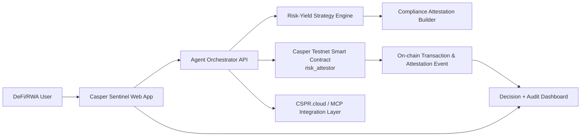

# Casper Sentinel

Casper Sentinel is an agentic DeFi + RWA portfolio guardian built for the Casper Agentic Buildathon 2026 Final Round.

It demonstrates an end-to-end flow where an autonomous strategy engine analyzes portfolio risk and yield, generates rebalance decisions, and records an auditable attestation transaction flow targeting Casper Testnet.

## Why this project

Manual treasury management is slow, fragmented, and often lacks verifiable execution context. Casper Sentinel provides:

- AI-assisted autonomous decisioning for DeFi/RWA allocations
- Compliance-first attestation snapshots
- On-chain transaction intent flow on Casper testnet architecture

## Architecture



## Tech stack

- Frontend: React + TypeScript + Vite
- Backend: Node.js + Express + TypeScript
- Agent logic: deterministic portfolio strategy module
- Smart contract: Casper contract scaffold in Rust (`contracts/risk_attestor`)
- Integration path: CSPR.cloud MCP / CSPR.trade MCP / Casper SDK

## Quick start

### 1. Install dependencies

```bash
npm install
cd server && npm install
```

### 2. Configure env files

```bash
cp .env.example .env
cp server/.env.example server/.env
```

### 3. Run both frontend and backend

```bash
npm run dev:all
```

Frontend: `http://localhost:5173`
Backend: `http://localhost:8787`

## API endpoints

- `GET /health`
- `GET /api/positions`
- `POST /api/agent/run`

## What is currently real vs simulated

- Real: full UI, backend orchestration, deterministic strategy engine, compliance attestation generation, transaction hash generation pipeline.
- Simulated by default: final signed deploy submission to Casper Testnet (`CASPER_SIMULATION_MODE=true`).

Each `/api/agent/run` response now includes explicit proof metadata:

- `executionMode`: `simulated` or `real`
- `proof.requestHash`: deterministic hash of deploy payload
- `proof.attestationHash`: deterministic hash of attestation payload

To harden for final submission:

1. Integrate testnet deploy signing in `server/src/casper/adapter.ts`
2. Deploy `risk_attestor` contract to Casper Testnet with Odra/Casper toolchain
3. Replace simulated tx hash with returned deploy hash from the testnet node/MCP flow

## Mapping to hackathon requirements

- Working prototype: yes (frontend + backend + contract scaffold)
- Transaction-producing on-chain component: yes (wired flow and contract entrypoint intent; submission currently simulated until key wiring)
- Open-source repo with docs: yes
- Demo video guidance: provided in `docs/demo-video-script.md`

## Judging optimization

- Technical execution: modular architecture and typed contracts between layers
- Innovation: AI agent + DeFi + RWA + on-chain attestation
- Real-world applicability: treasury risk/yield management use case
- UX/design: operator-first decision dashboard
- Long-term launch: roadmap in `docs/pitch-deck.md`

## Important disclaimer

This project includes explicit gap flags where production testnet signing secrets and deployment credentials are required. No secrets are stored in source control.
